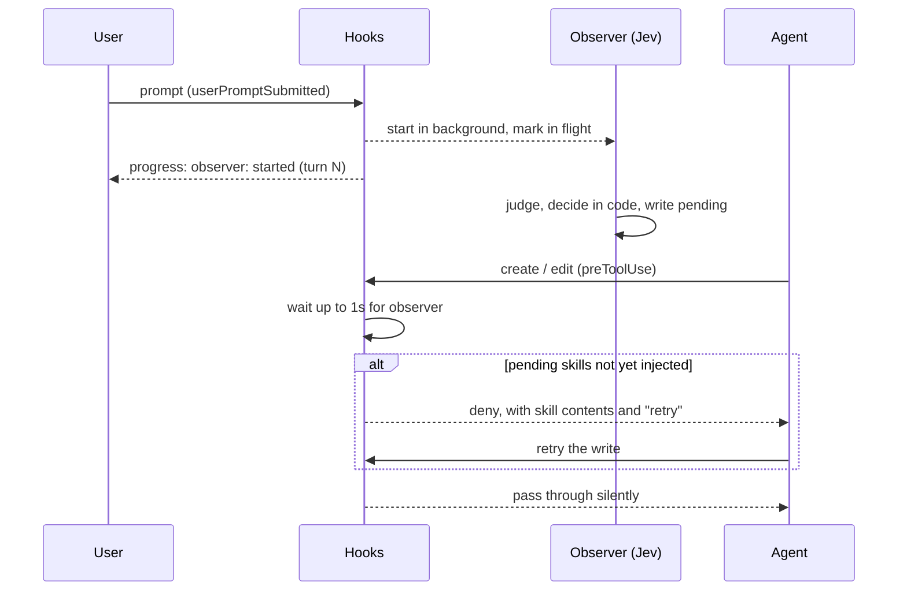

# skill-observer

Injects skill instructions into a Copilot session at the moment the agent starts doing work, so the agent never has to decide whether to load a skill.

A small, fast observer model (TypeSafe's Jev) watches each prompt in the background. When the agent's first file write of the turn arrives, a hook blocks it and hands the agent the relevant skills. The agent then retries the write with them in view.

## Why

- Agents often fail to invoke skills on their own.
- Listing dozens of skill descriptions up front bloats every context.

The observer replaces both: only the skills that apply are injected, once, at the switch from discussing to doing (for example, "ok, write the script").

## How it works



Per turn:

1. **`userPromptSubmitted`**: bumps the turn, clears the last verdict, and starts `worker.ts` detached. It returns immediately.
2. **The worker**: sends Jev the last few turns from the session transcript, a one-line task summary, and one yes/no question per skill that isn't injected yet. Code turns the answers into `pending` (see [the decision table](#decision-table)).
3. **`preToolUse`** (`create`, `edit`, `apply_patch`, `str_replace_editor`): if the observer for this turn is still running, waits up to `SKILL_OBSERVER_WAIT_MS`. If any `pending` skill hasn't been injected for this agent yet, denies the call with the skill contents and records the injection. Otherwise it passes silently.
4. **`preCompact`**: forgets injected skills, since compaction can drop them from context.

### Decision table

Jev makes the judgments; [questions.ts](./questions.ts) holds the wording, the thresholds, and this table:

| Is the user asking for work now? (`acting`) | Does the skill apply? (`relevance`) | Outcome |
|---|---|---|
| below 0.3 | any | NONE: still discussing |
| 0.3 or above | 0.7 or above | inject |
| 0.3 or above | below 0.7 | skip that skill |

The thresholds lean towards silence. A false positive pollutes context; a false negative only costs a nudge on a later turn.

### State

One JSON file per session in `$TMPDIR/skill-observer-<uid>/`, with a matching `.log`:

- `turn`, `observer` (in flight), `pending`
- `injected`: skill, turn, time, and agent (`main` or a subagent ID, since each has its own context)

Injected skills are cleared on compaction, or when the gap between prompts exceeds `SKILL_OBSERVER_STALE_MS`.

The log records turns, verdicts with their probabilities, and injections. It never records prompt text.

## Setup

1. Install dependencies with `bun install`.
2. Set `TYPESAFE_API_KEY` in the environment the Copilot runtime starts from. Hooks inherit it.
3. Hooks are configured in [.github/hooks/skill-observer.json](../.github/hooks/skill-observer.json). Start a new Copilot session in this repository to load them.

To use it in another repository, copy that JSON there and point the commands at this folder with absolute paths. Then set `SKILL_OBSERVER_SKILLS_DIRS` to the skills to watch.

> [!IMPORTANT]
> Keep observed skills out of the folders Copilot discovers by itself (`.github/skills`, `.claude/skills`, `.agents/skills`). Otherwise their descriptions are listed up front as well.

## Configuration

| Variable | Default | Purpose |
|---|---|---|
| `TYPESAFE_API_KEY` | required | API key for the observer. Without it, the observer logs an error and stays silent. |
| `SKILL_OBSERVER_SKILLS_DIRS` | `skills` in this repo | `:`-separated folders of `<skill>/SKILL.md`. |
| `SKILL_OBSERVER_STATE_DIR` | `$TMPDIR/skill-observer-<uid>` | Where state files and logs go. |
| `SKILL_OBSERVER_WAIT_MS` | `1000` | How long a write waits for an in-flight observer. |
| `SKILL_OBSERVER_TIMEOUT_MS` | `20000` | When a running observer is treated as dead. |
| `SKILL_OBSERVER_STALE_MS` | 2 hours | Gap between prompts that clears injected skills. |
| `SKILL_OBSERVER_RECENT_TURNS` | `3` | Turns of conversation sent to the observer. |
| `SKILL_OBSERVER_MODEL` | SDK default | TypeSafe model override. |
| `COPILOT_HOME` | `~/.copilot` | Where session transcripts are read from. |

## Copilot specifics

- Command `userPromptSubmitted` hooks can't add context; their output is dropped. That's why injection happens at `preToolUse`.
- Notices to the user are `{"type":"progress"}` lines on stdout. The Copilot docs describe them for the CLI timeline. Whether the VS Code chat shows them is unverified; the denied tool call and its reason are visible either way.
- A crashing `preToolUse` command hook denies the tool call. `hook.ts` therefore catches every error, logs it, and exits `0` with `{}`.
- Hook payloads carry no transcript, so the worker reads `$COPILOT_HOME/session-state/<sessionId>/events.jsonl`. It skips subagent messages. When the file is missing, it falls back to the prompts in the state file.

## Debugging

```bash
tail -f "${TMPDIR:-/tmp}/skill-observer-$(id -u)"/*.log
```

```text
turn 2: observer started (pid 17279)
observer turn 2: git-always-commit, ts-write-script (acting=0.98 git-always-commit=0.73 ts-write-script=0.91; jev-1.14.0, 230ms)
turn 2: blocked create (main), injected git-always-commit, ts-write-script
```

Run the tests with `bun test skill-observer`. They don't call the API.
